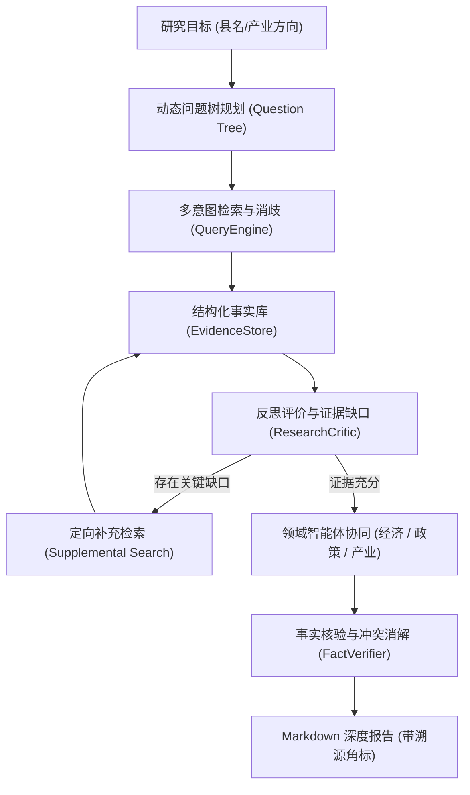

## 为什么做这个项目

县域产业研究需要在公开统计报表、政策文件与企业报道之间反复检索、多维交叉比对与口径校验。传统单次 Prompt 生成极易产生宏观套话，且无法保证多源数据的一致性。

该项目旨在构建一套严密的 **Plan-and-Execute 多 Agent 研究系统**，将宽泛的研究目标拆解为可执行的动态问题树，协调领域 Agent 协同深挖，并通过 Critic 反思评估证据覆盖度以自动触发补充检索，最终产出附带细粒度溯源角标的 Markdown 深度研究报告。

## 多 Agent 系统架构演进

系统从早期的单 Agent 演进为当前的多角色协作体系，通过动态问题树、结构化事实库、反思评价和事实校验器构成完整闭环：



### 核心机制

1. **动态问题树拆解**：根据研究模式（产业现状、兴衰演变、长周期历史），自顶向下将主题分解为发展规模、要素成本、供应链配套、政策引导等细分子问题。
2. **结构化证据库与口径归因**：检索产物存入 `EvidenceStore`，不仅记录正文片段，更提取具体年份、指标口径与来源权威度。系统能自动比对不同来源在同一指标上的数值差异（如不同年份统计公报与行业研报的产值统计口径冲突），显式标注口径不一致。
3. **Critic 反思补检机制**：`ResearchCritic` 在领域 Agent 撰写前介入，计算当前证据对核心问题树分支的覆盖度，一旦发现关键经济指标或政策节点缺失，自动生成定向 query 触发追问补检。
4. **状态校验与执行追踪**：采用 Pydantic 校验全部动作与状态流转；支持规则规划兜底以防 LLM 格式解析抖动；持久化包含单步耗时、工具调用与失败归因的完整 JSON Trace。

## 验证与工程边界

截至 2026 年 10 月 14 日，本地与 CI 流水线核验记录为 **299 项 pytest 测试全部通过**，核心模块测试覆盖率达 85%：

```bash
python -m pytest tests -q --no-cov -p no:cacheprovider -m 'not integration and not slow'
```

- **测试分层**：使用 Mock 全面隔离外部网络与 LLM API，对问题树节点裂变、Critic 补检中断条件、口径冲突检测算法及 JSON Trace 完整性提供回归保护。
- **真实基准评测 (Benchmark)**：内置涵盖安吉县竹产业、信丰县脐橙产业、鹤岗市产业转型的三套客观基准数据集，评估真实场景下的 Claim-Evidence 闭环支持率与权威来源占比。
- **边界认知**：测试集的 299 项通过保障的是 Agent 系统的**运行可靠性、状态幂等性与降级契约**，不代表公开网页检索能获取到所有未公开的涉密经济数据；生成报告定位为“高质量研究初稿”，需配合人工核查。

## 代码与文档入口

[项目仓库与运行说明](https://github.com/OrdoAbChao7/CountyResearchAI) · [Agent 源码目录](https://github.com/OrdoAbChao7/CountyResearchAI/tree/master/src/county_research_ai) · [基准评测报告](https://github.com/OrdoAbChao7/CountyResearchAI/blob/master/docs/BENCHMARK_REPORT.md)

内容更新：2026-10-14；测试验证记录：2026-10-14。
