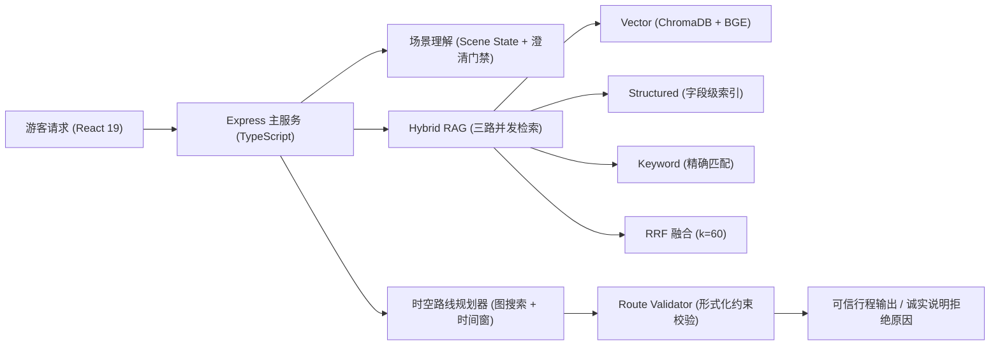

## 项目背景与定位

在景区实际导览中，游客常常提出复合型约束需求，例如：“我带腿脚不方便的母亲，在入口处只有 3 小时，想看一场演出，该怎么走？”

通用大语言模型直接生成行程极易产生幻觉：安排不存在的道路、忽略轮椅台阶无障碍限制、或者演出时间窗口冲突。**灵小禅的核心思路是将“语义理解”与“物理决策”彻底解耦**：
- **LLM + 规则抽取**：负责从非结构化自然语言中解析出当前位置、剩余时长、行动能力、演艺偏好等结构化 Scene State；
- **确定性时空规划器**：基于真实路网拓扑与演艺时间表，计算真实步行距离与时间窗口，进行形式化可行性校验。

## 系统架构与双引擎职责

### 1. 确定性路线规划与形式化校验
依托灵山胜境 23 个核心景点节点与 30 条道路边拓扑数据，针对老人与轮椅游客自动过滤台阶与陡坡；针对演艺场次进行时间重叠与路程缓冲预算校验。在 60 项典型游客路线的形式化验证用例中，实现了**零硬性物理违规**（如翻越无通道区域、错过演出入场时间）。

### 2. 诚实拒绝与状态机降级
系统通过置信度门禁与可行性状态机处理异常输入：
- `needs_clarification`：关键条件（如起点或时间预算）缺失时，主动向游客追问，绝不无依据瞎猜；
- `infeasible` / `feasible_with_rejected_preferences`：当 3 小时预算无法走完 5 个分散景点时，明确告知不可行或舍弃次要偏好，并给出具体耗时原因。

### 3. 三路混合检索与 RRF 融合
对于票价、政策等事实类问答，Express 主服务通过 `Promise.all` 并发调度向量单路、结构化属性索引与精确关键词三路，使用 Reciprocal Rank Fusion（RRF, $k=60$）进行无量纲分数融合，并交由 Express 统一组装执行 Trace 与来源片段。

## 评测与受控消融实验

为了衡量检索链路与事实可信度，团队维护了一套包含 50 题的基准事实评测集，以事实契约（Fact Contract）判定核心实体与数值是否无误命中：

| 实验配置 | 事实契约通过率 | 平均事实召回 | 平均耗时 |
| :--- | :--- | :--- | :--- |
| 向量单路 (Vector-only) | 94%（47/50） | 0.960 | 2336.08 ms |
| 完整三路方案 (Hybrid + RRF) | **98%（49/50）** | **0.980** | 2882.68 ms |

消融结果显示：结构化与关键词检索有效弥补了向量检索在特定数字、时间与专有名词（如“梵宫演出时间场次”）上的语义漏召；同时，Express 接口统一输出端到端执行 Trace，实现回答生成可回溯、可审计。

## 开源仓库与消融报告

[项目开源仓库 (lingshan-ai-guide-ablation)](https://github.com/OrdoAbChao7/lingshan-ai-guide-ablation) · [消融实验报告与复现台账](https://github.com/OrdoAbChao7/lingshan-ai-guide-ablation/blob/main/docs/competition/feature-contract.md)

内容更新：2026-10-15；形式化验证与消融记录：2026-10-15。
